  
  
  
  
  
  
  

# ⚖️ Awesome Enterprise Contract Intelligence Platform 🧠

### 🚀 Top Enterprise Contract Intelligence Platform & CLM Ecosystem
**Curated Index of Enterprise SaaS Platforms & Self-Hosted Open-Source GitHub Projects**  
*Focused on AI-Powered Clause Extraction, Post-Signature Obligation Tracking, Citation Graphs & Legal Reasoning*  
📅 **Last updated: March 2026**

---

## 📌 Executive Summary & Architecture

This repository tracks notable **enterprise SaaS platforms** and **open-source legal AI projects** for **Enterprise Contract Intelligence** and **Contract Lifecycle Management (CLM)**. These platforms advance beyond basic digital document repositories—leveraging Large Language Models (LLMs), Natural Language Processing (NLP), and vector-graph retrieval to extract contractual obligations, flag liabilities and non-standard risks, and surface portfolio-wide commitments from executed agreements.

- 🏢 **Enterprise Leaders**: Icertis, SirionLabs, Ironclad, Workday Contract Intelligence (Evisort), DocuSign CLM, Agiloft, Conga, ContractPodAi, Luminance, and CobbleStone.
- 🔓 **Open-Source Champions**: Mike, Catala, OpenContracts, CUAD, LegalQuants AI, ally-legal-assistant, OpenCapture, draftLegal, and Aakd.

> 💡 **Data Sovereignty & Self-Hosting**: Open-source contract intelligence provides verifiable audit trails, local model inference (via Ollama/vLLM), and portfolio citation graphs without 6-figure SaaS licensing commitments.

---

## 📑 Table of Contents

- [📊 Sector Overview & Market Dynamics](#-sector-overview--market-dynamics)
- [🏢 SaaS/Hosted Enterprise Platforms](#-saashosted-enterprise-platforms)
- [🔓 Open-Source GitHub Projects](#-open-source-github-projects)
- [🤝 How to Contribute](#-how-to-contribute)
- [💖 Support & Sponsorship](#-support--sponsorship)
- [📈 Star History](#-star-history)
- [⚠️ Disclaimer](#️-disclaimer)

---

## 📊 Sector Overview & Market Dynamics

The global Contract Lifecycle Management (CLM) and Contract Intelligence market is valued between **$2.0 billion and $3.8 billion** (scaling at a steady 11%–13% CAGR), driven by enterprise migration from static storage to AI-driven clause extraction, risk scoring, and post-signature obligation tracking. The market is **moderately fragmented across 150+ point solutions and specialized AI wrappers at the mid-market level, but increasingly concentrated at the top tier**, where enterprise buyers favor comprehensive, multi-billion-dollar platform ecosystems (such as Workday, DocuSign, and Icertis) that natively integrate with core ERP and CRM systems.

---

## 🏢 SaaS/Hosted Enterprise Platforms

| Product | Company Size (Valuation / Revenue) | Pricing (Starting) | Free Tier / Trial Limits | Description |
|---------|------------------------------------|-------------------|--------------------------|-------------|
| **[Evisort (Workday)](https://www.evisort.com/)** | **~$48B market cap** / **~$9.6B annual rev** (Parent: Workday, NASDAQ: WDAY) | ~$30,000–$45,000/year (quote-based enterprise subscription scaled by contract volume) | No free tier; no public free trial (0 days; evaluation via sales demo and custom enterprise POC) | **Contract AI folded into Workday.** Acquired by Workday and integrated as Workday Contract Intelligence. Scored 3.96 in Postsignature and 3.89 in Presignature use cases. Brings contract AI inside one of the largest enterprise software platforms. |
| **[DocuSign CLM](https://www.docusign.com/)** | **~$15B market cap** / **~$3.2B annual rev** (NASDAQ: DOCU) | ~$10,000–$36,000/year (approx. $800–$1,060/user/year; quote-based enterprise contract) | No free tier for CLM; 30-day free trial limited strictly to eSignature only (CLM requires enterprise sales demo) | **Natural extension for companies already standardized on DocuSign signatures.** Full lifecycle CLM with strong e-signature heritage. Scored 3.82 in Full Life Cycle and 3.43 in Advanced Contract Analytics. |
| **[Icertis](https://www.icertis.com/)** | **~$5B valuation** / **~$350M ARR** (backed by SoftBank, SAP) | ~$80,000–$100,000/year (approx. $150–$350/user/month; quote-based enterprise deployment) | No free tier; no public free trial (0 days; sales demo and guided enterprise POC only) | **Enterprise leader for obligation management and compliance at scale.** Gartner and Forrester position Icertis for large organizations with complex processes driven by post-signature obligation tracking. AI discovers commercial terms, compliance obligations, and risk markers. |
| **[Ironclad](https://ironcladapp.com/)** | **$3.2B valuation** / **~$200M+ ARR** (Series E) | ~$25,000–$35,000/year base (approx. $200–$600/user/month depending on editor seats; custom quote) | No free tier; no public free trial (0 days; custom enterprise demonstration and scoped POC only) | **Most common enterprise default for AI-first contracting.** Named a Gartner Magic Quadrant Leader and Forrester Wave leader. Praised for usability, strong Salesforce integration, native e-signature, and highly adopted AI features. |
| **[Conga](https://www.conga.com/)** | **~$1.6B+ valuation** / **~$400M+ revenue** (Thoma Bravo portfolio) | ~$35/user/month (~$420/user/year entry tier; typical enterprise deployments start at $15,000+/year) | No free tier; no free trial (0 days; evaluation via guided sales demo and scoping) | **CLM with structured approval workflows and contract analytics.** Formed via the combination of Apttus and Conga under Thoma Bravo. Scored 3.63 in Full Life Cycle and 2.81 in Advanced Contract Analytics. |
| **[SirionLabs](https://www.sirion.ai/)** | **~$1B valuation** / **~$85M+ ARR** (majority acquired by Haveli Investments) | ~$1,500/user/year (~$90–$330/user/month; enterprise minimum commitments often starting around $80,000/year) | No free tier; no free trial (0 days; evaluation via custom sales demo and scoped POC) | **Specialist in supplier and post-signature obligations.** Ranked #1 in Gartner's Advanced Contract Analytics use case (score 4.03/5) and #2 in Postsignature (4.22/5). AI-driven analytics mine the portfolio for performance insights and risk analytics. |
| **[ContractPodAi](https://contractpodai.com/)** | **~$695M valuation** / **~$50M ARR** (backed by SoftBank Vision Fund 2) | ~$50,000/year starting subscription (quote-based enterprise annual contract) | No free tier; no free trial (0 days; personalized sales demo and custom pilot) | **AI-powered legal platform (Leah) with contract management, review/analysis, and legal project management.** Scored 3.89 across all three primary use cases and 3.93 in Advanced Contract Analytics—second only to Sirion. |
| **[Agiloft](https://www.agiloft.com/)** | **~$500M+ est. valuation** (KKR buyout) / **~$70M+ ARR** | ~$15,000–$67,000/year (quote-based enterprise licensing; standalone AI add-on from $120/month) | No free tier; no free trial (0 days for core CLM platform; evaluation via custom sales demo) | **No-code CLM with the highest Full Life Cycle score in Gartner's evaluation (4.08/5).** Also strong in Presignature (4.11) and Postsignature (4.02). No-code platform with multitenant SaaS, dedicated server, or on-premises deployment options. |
| **[Luminance](https://www.luminance.com/)** | **~$150M–$200M est. valuation** (Series C) / **~$30M–$60M ARR** | ~$43,000–$60,000/year (quote-based; priced by document volume processed and module scope) | No free tier; no free trial (0 days; guided enterprise demo and pilot order form agreement) | **Legal-grade AI that surfaces portfolio-wide trends in payment terms, liability exposure, and commercial commitments.** Source-backed answers with clause-level citations; features specialized proprietary legal LLMs (Luna). |
| **[CobbleStone](https://www.cobblestonesoftware.com/)** | **~$25M–$30M annual revenue** (Bootstrapped / Privately held) | ~$59/user/month (Express entry-level tier; enterprise editions quote-based with core licensing + user packs) | 30-day free trial available (hands-on trial period with configuration support) | **CLM with VISDOM AI for clause extraction, risk flagging, and post-execution compliance tracking.** Scored 3.75 in Full Life Cycle and 3.69 in Postsignature. |

---

## 🔓 Open-Source GitHub Projects

Curated open-source software, legal reasoning systems, citation graphs, and AI contract review tooling, sorted by GitHub stars in descending order:

| Project | GitHub Stars | Description |
|---------|--------------|-------------|
| **[Mike](https://github.com/open-legal-products/mike)** |  | **Open-source Legal AI platform for contract generation, processing, and redlining.** Features Microsoft Word add-in integration, local offline LLM inference via Ollama, structured clause libraries, and audit-ready document exports. |
| **[Catala](https://github.com/CatalaLang/catala)** |  | **Domain-specific programming language for formalizing law and contractual specifications as code.** Developed by French research institute Inria. Serves as a deterministic, mathematically verifiable rules engine for legal logic and obligations. |
| **[OpenContracts](https://github.com/Open-Source-Legal/OpenContracts)** |  | **Open-source citation graph substrate and document intelligence platform (MIT licensed).** Represents contracts as nodes, citations as edges, and provisions as human/agent annotations. Includes version-controlled corpuses and a native Model Context Protocol (MCP) server for Claude and Cursor. |
| **[CUAD (The Atticus Project)](https://github.com/The-Atticus-Project/cuad)** |  | **Curated benchmark dataset and NLP model architecture for contract understanding.** Standardized over 510+ commercial legal agreements and 13,000+ annotations across 41 actionable clause risk categories for fine-tuning extraction pipelines. |
| **[LegalQuants AI](https://github.com/LegalQuants/lq-ai)** |  | **Self-hosted Legal AI platform for contract analysis and private document review.** Features privacy-preserving anonymization layers, codified legal playbooks, multi-document tabular cross-analysis, and support for air-gapped local LLMs. |
| **[Ally Legal Assistant](https://github.com/Azure-Samples/ally-legal-assistant)** |  | **Enterprise-grade contract review and legal assistant plugin for Microsoft Word.** Provides clause suggestion engines, contextual contract Q&A, and redline diffing backed by Azure OpenAI and enterprise security standards. |
| **[Open-Capture](https://github.com/Edissyum/opencapture)** |  | **Fully open-source document ingestion and capture solution (GPL v3).** Specialized intake pipeline for high-volume contract OCR, document classification, and metadata extraction upstream of legal intelligence engines. |
| **[draftLegal](https://github.com/AniketTati/draft-legal)** |  | **AI-native open-source contract reasoning CLM platform.** Features ~30 legal agent tools, portfolio-wide hybrid retrieval (pgvector + Elasticsearch + RRF fusion), citation-grounded question answering, and bring-your-own-model deployment via Docker Compose. |
| **[Aakd](https://github.com/aaked-app/aakd)** |  | **Focused open-source post-signature obligation and renewal tracker (AGPL-3.0).** Parses executed agreements into reviewable obligation cards with exact page-level citations, human-in-the-loop verification, and automated renewal deadline reminders. |

---

## 🤝 How to Contribute

Contributions are warmly welcome! Help make enterprise contract intelligence more open, auditable, and accessible:

1. 🍴 **Fork the repository** to your personal GitHub account.
2. 🌿 **Create a descriptive feature branch** (`git checkout -b feature/add-new-clm-project`).
3. 📝 **Add or edit entries in `README.md`** following the established table schema (ensure all pricing, company size metrics, and star badges follow guidelines).
4. 🚀 **Commit your updates** with a clear message (`git commit -m "Add new open-source contract analysis tool"`).
5. 🔀 **Submit a Pull Request** with a brief summary of additions or updates.

---

## 💖 Support & Sponsorship

If you find this curated ecosystem list helpful for your legal engineering work, research, or enterprise tooling:

- ⭐ **Star this repository** to help others discover it!
- 🍴 **Fork it** to customize your internal legal tech evaluations.
- 📣 **Share it** with your legal ops, procurement, and engineering teams.
- ☕ **Buy me a coffee & support ongoing curation**: Consider sponsoring the creator at the [GitHub Sponsors Dashboard](https://github.com/sponsors/ishandutta2007) 🙏

---

## 📈 Star History

---

## ⚠️ Disclaimer

- This is a **community-curated index** — not exhaustive and not an official corporate endorsement.
- Contract intelligence platforms handle legally binding agreements, privileged communications, and sensitive commercial data; always enforce strict role-based access control (RBAC), end-to-end encryption, and regulatory compliance (GDPR, HIPAA, SOC 2).
- **AI-generated extractions, obligation summaries, and risk assessments should always be validated by qualified legal counsel.**

---

  <b>Built for legal ops teams, contract analysts, and engineers building the next generation of contract intelligence infrastructure.</b>  
   
  Maintained with ❤️ by <a href="https://github.com/ishandutta2007">Ishan Dutta</a>

